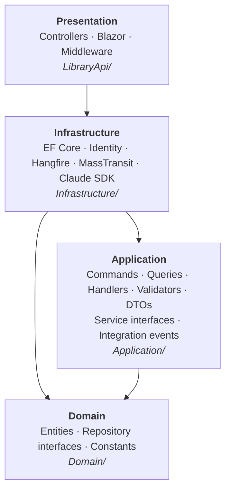
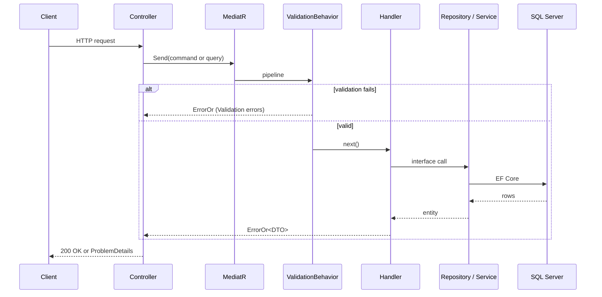
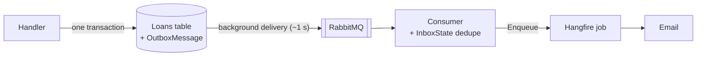

# Library API

A library-management Web API (books, categories, members, loans) built on **ASP.NET Core / .NET 10** with **Clean Architecture** and **CQRS**. It also serves a small Blazor Server UI, an AI chat endpoint backed by Claude, background email through Hangfire, and integration events over RabbitMQ.

| Concern | Technology |
|---|---|
| Web host | ASP.NET Core Web API + Blazor Server |
| CQRS / mediator | MediatR |
| Results | ErrorOr |
| Validation | FluentValidation |
| Mapping | Mapster (convention-based) |
| Persistence | EF Core + SQL Server |
| Identity | ASP.NET Core Identity (cookie auth, roles) |
| Background jobs | Hangfire (SQL Server storage) |
| Email | FluentEmail + MailKit |
| Messaging | MassTransit 8.x + RabbitMQ, transactional outbox |
| AI | Official `Anthropic` .NET SDK |
| Logging | Serilog |
| Tests | xUnit + Moq |

---

## Contents

1. [Architecture: the layers](#1-architecture-the-layers)
2. [Solution layout](#2-solution-layout)
3. [How a request flows](#3-how-a-request-flows)
4. [Design patterns](#4-design-patterns)
5. [Domain rules: lending](#5-domain-rules-lending)
6. [API reference](#6-api-reference)
7. [Authentication and authorization](#7-authentication-and-authorization)
8. [Integration events](#8-integration-events)
9. [Background jobs and email](#9-background-jobs-and-email)
10. [Claude AI chat](#10-claude-ai-chat)
11. [Blazor UI](#11-blazor-ui)
12. [Cross-cutting concerns](#12-cross-cutting-concerns)
13. [Testing](#13-testing)
14. [Deployment](#14-deployment)
15. [Known limitations](#15-known-limitations)

---

## 1. Architecture: the layers

The solution follows Clean Architecture. **Dependencies always point inward**: outer layers know about inner ones, never the reverse.



### Domain — the core

`Domain/` has **no dependencies at all**, not even NuGet packages.

- **Entities** (`Domain/Entities/`): `BookModel`, `CategoryModel`, `MemberModel`, `LoanModel`, `PasswordResetCodeModel`.
- **Repository interfaces** (`Domain/RepositoryInterfaces/`): `IBooksRepository`, `ILoansRepository`, and so on. They live here, not in Application, because a repository is part of the domain model: it is a collection of aggregates. They reference only entities and the BCL.
- **Constants** (`Domain/Constants/`): `Roles`, `PasswordResetRules`, `ChatHistory`.

### Application — the use cases

`Application/` depends only on Domain. It holds every business use case and **declares** the abstractions it needs from the outside world without implementing them.

- **Features** (`Application/Features/<Area>/`): one vertical slice per use case (see [Vertical slices](#vertical-slice-architecture)).
- **DTOs** (`Application/DTOs/`): immutable `record`s returned to callers.
- **Service interfaces** (`Application/ServiceInterfaces/`): `IEmailService`, `IIdentityService`, `IEventPublisher`, `IUnitOfWork`, `ILoanPolicy`, `IClaudeService`, `IChatHistoryStore`, `IAiUsageLimiter`, `IVerificationCodeService`.
- **Pipeline behaviors** (`Application/Behaviors/`): `ValidationBehavior<,>`.
- **Integration events** (`Application/IntegrationEvents/`): `BookBorrowed`, `BookReturned`, `MemberRegistered`.
- **Jobs** (`Application/Jobs/`): Hangfire job classes for the welcome, password-reset, loan-receipt and return-receipt emails.

No EF Core, MassTransit, Identity or SDK type ever reaches this layer.

### Infrastructure — the adapters

`Infrastructure/` implements what Application and Domain declare:

- `Data/LibraryDBContext.cs`: the EF Core context, extending `IdentityDbContext<IdentityUser>`.
- `Repositories/`: EF Core repositories plus `UnitOfWork`.
- `Configurations/`: `IEntityTypeConfiguration` classes holding seed data, indexes and check constraints.
- `Services/`: `EmailService`, `IdentityService`, `ClaudeService`, `ConfiguredLoanPolicy`, the in-memory chat store and AI usage limiter, and `VerificationCodeService`.
- `Messaging/`: `OutboxEventPublisher`, `NoOpEventPublisher`, and the RabbitMQ consumers.
- `Identity/IdentitySeeder.cs`: creates the roles and the seed admin account.
- `DependencyInjection.cs`: `AddInfrastructure`, which wires all of the above.

### Presentation — the host

`LibraryApi/` (project `Presentation.csproj`) references only Infrastructure. Application and Domain arrive transitively.

- `Controllers/`: thin API controllers.
- `Components/`: the Blazor Server UI.
- `MiddleWare/`: `GlobalExceptionMiddleware` and `AdminOnlyPathMiddleWare`.
- `Extensions/`: `ErrorExtensions.ToProblem`, `AdminAccess`, and `HangfireDashboardAuthorization`.
- `HealthChecks/`: `DatabaseHealthCheck`.
- `Program.cs`: the composition root.

---

## 2. Solution layout

The solution file is **`LibraryApi.slnx`** at the repository root.

```
LibraryApi.slnx
├── Domain/                     Domain.csproj           (no references)
├── Application/                Application.csproj      → Domain
├── Infrastructure/             Infrastructure.csproj   → Application, Domain
├── LibraryApi/                 Presentation.csproj     → Infrastructure
├── tests/
│   ├── Application.UnitTests/
│   ├── Infrastructure.UnitTests/
│   └── Presentation.UnitTests/
├── docker-compose.yml          (local RabbitMQ)
└── .github/workflows/build-and-test.yml
```

> The web host's folder is `LibraryApi/` but its project is `Presentation.csproj` (assembly `Presentation`, root namespace `LibraryApi`).

---

## 3. How a request flows

Every endpoint follows the same thin, uniform path:



1. **Controller**: injects only `IMediator`, sends a command or query, and returns
   `result.Match(ok => Ok(ok), errors => this.ToProblem(errors))`. Controllers contain no logic.
2. **Command / query**: a `record` implementing `IRequest<ErrorOr<TDto>>`.
3. **`ValidationBehavior<,>`**: runs every registered `IValidator<TRequest>` and short-circuits with `Error.Validation` results. It is constrained to `TResponse : IErrorOr`, so every request in the codebase returns `ErrorOr<T>`.
4. **Handler**: calls repository or service interfaces and returns a typed `Error` on the sad path instead of throwing.
5. **Mapping**: Mapster's `.Adapt<T>()` maps entities to DTOs by matching member names.
6. **Error mapping**: `ErrorExtensions.ToProblem` turns errors into RFC 7807 `ProblemDetails`:

| `ErrorType` | HTTP status |
|---|---|
| Validation (all errors) | 400 `ValidationProblemDetails` |
| NotFound | 404 |
| Conflict | 409 |
| Unauthorized | 401 |
| Forbidden | 403 |
| Unexpected | 500 |
| Failure | 400 |

A real example, from `LoansController`:

```csharp
[HttpGet("overdue")]
public async Task<IActionResult> GetOverdueLoans()
{
    var result = await _mediator.Send(new GetOverdueLoansQuery());

    return result.Match(
        loans => Ok(loans),
        errors => this.ToProblem(errors));
}
```

---

## 4. Design patterns

### Clean Architecture / Dependency Inversion
Application declares interfaces such as `IEmailService`, `IEventPublisher` and `ILoanPolicy`, and Infrastructure implements them. Business logic depends on abstractions, never on SMTP, RabbitMQ or configuration, so it can be unit-tested with mocks and its infrastructure swapped out.

### CQRS (Command Query Responsibility Segregation)
Writes are **commands** (`AddLoanCommand`, `ReturnLoanCommand`) and reads are **queries** (`GetOverdueLoansQuery`, `SearchBooksQuery`). Each has its own handler, so read paths can be optimised (paging, `AsNoTracking`, SQL-side counts) without affecting writes.

### Mediator
MediatR decouples the sender from the handler. Controllers and Blazor components both send the same request objects, so the UI and the API share one implementation of each use case. `Login.razor` and `AuthController.Login` both send `LoginCommand`, for example.

### Pipeline (Chain of Responsibility)
`ValidationBehavior<,>` is a MediatR pipeline behavior that wraps every handler. Cross-cutting checks are written once instead of being repeated in each handler.

### Vertical slice architecture
Features are organised by use case rather than by technical type. A slice is three files with matching names:

```
Application/Features/Loans/Commands/AddLoanCommand.cs           // the request
Application/Features/Loans/Commands/AddLoanCommandHandler.cs    // the logic
Application/Features/Loans/Commands/AddLoanCommandValidator.cs  // the rules
```

Handlers and validators are discovered by assembly scanning in `Application/DependencyInjection.cs`, so a new slice needs no registration.

### Result pattern
Failures are **returned, not thrown**. Every handler returns `ErrorOr<T>` carrying a specific, coded error such as `Loans.BookNotFound` or `Loans.NoCopiesAvailable`. A thrown exception would skip validation, the handler's contract and `ToProblem`, and surface as an opaque 500. Exceptions from third-party libraries (the Anthropic SDK, FluentEmail) are caught at the boundary and mapped to `Error`s. Even `AddInfrastructure` returns `ErrorOr<Success>`, so a misconfigured host prints `Cannot start: [code] description` and exits cleanly.

The one deliberate exception is the Hangfire jobs. Hangfire only retries a job that throws, so a job converts a returned failure into an exception (see [Background jobs](#9-background-jobs-and-email)).

### Repository
One repository per aggregate, with interfaces in Domain and EF Core implementations in Infrastructure. Conventions:
- reads use `AsNoTracking()`
- updates call `Update()` to attach the detached entity
- deletes use `ExecuteDeleteAsync()`, so deleting a missing id is a silent no-op
- every method takes a `CancellationToken`

### Unit of Work
`IUnitOfWork.ExecuteInTransactionAsync` runs several writes in one database transaction. It commits when the delegate returns a value and rolls back when it returns an error or throws.

### Transactional Outbox
Integration events are written to an `OutboxMessage` table **in the same transaction** as the business data, and a background service forwards them to RabbitMQ later. That gives "both or neither": no loan without its event, and no event for a loan that rolled back (see [Integration events](#8-integration-events)).

### Inbox (idempotent consumer)
Consumers record processed message ids in `InboxState` and drop redeliveries. That makes at-least-once delivery safe to act on.

### Publish / Subscribe
Handlers publish facts (`BookBorrowed`) without knowing who listens. Consumers subscribe and react, for example by queuing a receipt email. New reactions are added without touching the handler.

### Strategy / Null Object
`IEventPublisher` has two implementations chosen at startup: `OutboxEventPublisher` when RabbitMQ is configured, and `NoOpEventPublisher` when it is not. Handlers never branch on configuration.

### Policy object
`ILoanPolicy` (`ConfiguredLoanPolicy`) encapsulates how long a loan lasts. The handler asks the policy for a due date instead of reading configuration itself.

### Data Transfer Object
Entities (`*Model`) never cross the API boundary. Handlers return immutable `record` DTOs (`*DTO`). Derived values such as `LoansDTO.IsOverdue`, `BooksDTO.AvailableCopies` and `PagedResult.TotalPages` are **get-only computed members**, so they can never disagree with the data they are computed from.

### Options pattern
Typed settings classes (`EmailSettings`, `RabbitMqSettings`, and others in `Infrastructure/Settings/`) are bound from configuration sections.

### Middleware
`GlobalExceptionMiddleware` is the safety net that turns unexpected exceptions into a generic 500 `ProblemDetails`. `AdminOnlyPathMiddleWare` gates the `/swagger` path to admins.

### Lazy initialization
`ClaudeService` is a singleton holding a `Lazy<AnthropicClient>`. The client is built only once an API key exists, which keeps a missing key an `ErrorOr` failure rather than a DI exception.

---

## 5. Domain rules: lending

Loans are where the real domain rules live:

- **`POST /api/Loans` accepts only `{ bookId, memberId }`.** `BorrowedAt` and `DueAt` are stamped from the server clock, because a caller who could choose their borrow date could choose their due date too.
- **Ids are checked before insert.** An unknown book or member returns `404 Loans.BookNotFound` / `Loans.MemberNotFound` rather than a foreign-key violation and a 500.
- **Availability is computed, never stored**: `TotalCopies` minus open loans, counted in SQL. When every copy is out, the request gets `409 Loans.NoCopiesAvailable`.
- **Concurrent loans of the same book are serialised.** The handler locks the book row at the start of the lending transaction, so two requests for the last copy cannot both succeed.
- **Returning is the only way a loan changes.** `POST /api/Loans/{id}/return` refuses a second return (`Loans.AlreadyReturned`). There is deliberately no general update endpoint, because rewriting `BorrowedAt` or `DueAt` would corrupt the record.
- **The loan period** is `Loans:LoanPeriodDays` (default 14). A value of 0 or less falls back to 14.
- **`DueAt` is stored**, so changing the period affects only new loans.
- **`DaysOverdue` rounds down**, so always read it together with `IsOverdue`.
- **`TotalCopies` cannot be cut below the number on loan** (`Books.CopiesBelowActiveLoans`). A check constraint enforces `TotalCopies >= 1`.

---

## 6. API reference

All resource controllers require authentication (`[Authorize]`). Sign in first with `POST /api/Auth/login`; the cookie then carries over, including in Swagger.

### Auth — `/api/Auth`
| Method | Route | Auth | Purpose |
|---|---|---|---|
| POST | `/register` | anonymous | Create an account, a linked member and a welcome email |
| POST | `/login` | anonymous | Sign in (`rememberMe` makes the cookie persistent) |
| POST | `/forgot-password` | anonymous | Email a 7-character reset code |
| POST | `/reset-password` | anonymous | Reset the password with the code |
| POST | `/change-password` | signed in | Change the password (current password required) |
| POST | `/delete-account` | signed in | Delete the account (password required) |

### Books — `/api/Books`
| Method | Route | Purpose |
|---|---|---|
| GET | `/` | **Paged** search: `?page=&pageSize=&search=&sortBy=id\|title\|author\|totalCopies&descending=` |
| GET | `/{id}` | One book, with copies on loan and available |
| POST | `/` | Add |
| PUT | `/{id}` | Update (the route id wins over the body) |
| DELETE | `/{id}` | Delete |

### Categories — `/api/Categories`
CRUD: `GET /`, `GET /{id}`, `POST /`, `PUT /{id}`, `DELETE /{id}`.

### Members — `/api/Members`
CRUD: `GET /`, `GET /{id}`, `POST /` (name only; the id is generated), `PUT /{id}`, `DELETE /{id}`.

### Loans — `/api/Loans`
| Method | Route | Purpose |
|---|---|---|
| GET | `/` | All loans |
| GET | `/overdue` | Open loans past their due date (empty list if none) |
| GET | `/mine` | The caller's own loans (identity taken from the cookie) |
| GET | `/{id}` | One loan |
| POST | `/` | Lend a book: `{ bookId, memberId }` |
| POST | `/{id}/return` | Return a book |
| DELETE | `/{id}` | Erase a loan record (this is **not** returning it) |

### Other
| Method | Route | Purpose |
|---|---|---|
| GET | `/api/ClaudeAI?message=&conversationId=` | AI chat (see below) |
| GET | `/health` | Anonymous liveness probe (database reachability) |
| — | `/swagger` | API explorer, **Admin only** |
| — | `/hangfire` | Job dashboard, **Admin only** |

---

## 7. Authentication and authorization

- **ASP.NET Core Identity with cookie authentication.** JWT bearer is referenced but not configured.
- **One login path**: `AuthController` and `Login.razor` both send `LoginCommand` → `IIdentityService.LoginAsync` → `SignInManager`. A bad password returns **401**.
- **Accounts and members are separate.** `MemberModel.IdentityUserId` links them through a filtered unique index. Walk-in members have no account. Registration creates both, idempotently.
- **Roles**: `User` (granted at registration) and `Admin` (granted only by `IdentitySeeder` from `Identity:Admin:*` configuration). Roles gate Swagger and the Hangfire dashboard only.
- **Password reset**: only a SHA-256 hash of the code is stored. Codes expire after 15 minutes, only one is live per account, and five wrong guesses spend it. Responses are identical whether or not the address exists, so the endpoint cannot be used to enumerate accounts.
- **Cookies**: `HttpOnly` and `SameSite=Lax`, with a 14-day sliding lifetime. The security stamp is validated every minute, so a password change or account deletion signs out other sessions within a minute.
- **Caller identity is never model-bound.** Endpoints such as `/mine`, `change-password` and `delete-account` read the user id from the cookie's claims, never from the request.

---

## 8. Integration events

Integration events announce that something meaningful happened, so other code (or other services) can react without the originating handler knowing about them.

| Event | Published by | Consumer | Reaction |
|---|---|---|---|
| `BookBorrowed` | `AddLoanCommandHandler` | `BookBorrowedConsumer` | Queues a loan-receipt email |
| `BookReturned` | `ReturnLoanCommandHandler` | `BookReturnedConsumer` | Queues a return-receipt email |
| `MemberRegistered` | `RegisterCommandHandler` | — | Published for future subscribers |



How it works:
1. The handler wraps the entity write and `IEventPublisher.PublishAsync` in `IUnitOfWork.ExecuteInTransactionAsync`. If recording the event fails, the write rolls back.
2. `OutboxEventPublisher` only writes to the outbox table and **never contacts the broker**, so a RabbitMQ outage does not slow requests.
3. MassTransit's delivery service forwards outbox rows to RabbitMQ.
4. Consumers dedupe through the inbox, retry after 1 s, 5 s and 30 s, and move a message that still fails to the `_error` queue.
5. Consumers queue Hangfire jobs instead of sending email inline, so sends get Hangfire's retries and dashboard.

Notes:
- **Delivery is at-least-once.** A crash at the wrong moment can send an email twice.
- **With no RabbitMQ configuration** (Host, Username and Password all required), `NoOpEventPublisher` is used and no bus starts.
- **MassTransit is pinned to 8.x** on purpose: v9 is commercially licensed.
- **`/health` runs only checks tagged `core`**, so a broker outage does not mark a healthy instance as down.

---

## 9. Background jobs and email

- **Hangfire** uses SQL Server storage on the main connection and runs jobs in-process. Its schema is installed right after `Database.Migrate()` rather than during service registration.
- **Jobs**: `SendWelcomeEmailJob`, `SendPasswordResetEmailJob`, `SendLoanReceiptEmailJob` and `SendReturnReceiptEmailJob`.
- **Email**: `EmailService` uses FluentEmail + MailKit. It checks `response.Successful`, because FluentEmail swallows SMTP exceptions, and returns `Email.SendFailed`.
- **Jobs throw on failure.** Hangfire marks a job that returns as *Succeeded*, so a job turns a returned error into an exception. That is the only way to get Hangfire's automatic retries.
- **Job classes must be registered in DI.** Hangfire resolves them with `GetRequiredService`.

---

## 10. Claude AI chat

`GET /api/ClaudeAI?message=…&conversationId=…`, or the `/chat` page.

- `ClaudeAIController` → `AskClaudeQuery` → `AskClaudeQueryHandler` → `IClaudeService` → `ClaudeService` (official Anthropic SDK).
- Leave `conversationId` empty to start a chat. The reply returns an id to send on the next call.
- History is stored in memory (`IMemoryCache`, 30-minute sliding expiry) and capped at 20 messages. Messages are capped at 4000 characters.
- **Usage is limited to `Claude:MessagesPerWindow` messages per user per `Claude:RateLimitHours` hours.** Setting `MessagesPerWindow` to `0` turns the assistant off for everyone, answering `403 Claude.Disabled`. **It is currently `0`, so the chat is off.** The limit is enforced in the handler rather than on the endpoint, so it covers both the API and the Blazor page. An allowance is spent only when Claude actually answers.
- Calls are non-streaming so Swagger can display them. SDK exceptions are mapped to `Claude.*` errors.

---

## 11. Blazor UI

A Blazor Server UI is served from `LibraryApi/Components/`:

| Page | Route | Notes |
|---|---|---|
| Home | `/` | |
| Books, Categories, Members, Loans | management pages | Send MediatR requests in-process |
| Chat | `/chat` | Interactive (SignalR) |
| Login, Register, Forgot password, Account | `/login`, `/register`, `/forgot-password`, `/account` | Static SSR forms, because they must write the auth cookie |

Components call `IMediator` directly, with no HTTP hop back into the same app. Styling is a single hand-written `wwwroot/app.css`, with no JavaScript build step.

---

## 12. Cross-cutting concerns

| Concern | Implementation |
|---|---|
| **Validation** | FluentValidation through `ValidationBehavior<,>` |
| **Error handling** | `ErrorOr` results → `ToProblem` → `ProblemDetails`; `GlobalExceptionMiddleware` as the last resort |
| **Rate limiting** | Partitioned fixed window: 100 requests per caller per 2 minutes on the API, immediate 429, `/health` exempt |
| **Logging** | Serilog: console plus a daily rolling file `logs/library-.log` (14 days kept), one line per request |
| **Health** | `GET /health` → `DatabaseHealthCheck` (`CanConnectAsync`) |
| **Transport security** | `Security:RequireHttps` controls HTTPS redirection, HSTS and the `Secure` cookie flag together |
| **Migrations** | Applied automatically at startup with `Database.Migrate()` |

---

## 13. Testing

```bash
dotnet test LibraryApi.slnx
```

- **xUnit + Moq**, using xUnit's built-in `Assert` with no assertion library.
- One test project per production project; test files mirror the source paths.
- Handlers are tested against mocked interfaces, asserting the `ErrorOr` error **type and code**.
- Validators and Mapster mappings are covered, because a property rename breaks mapping silently.
- Repository tests use **SQLite in-memory**, not the EF InMemory provider, which does not support `ExecuteDeleteAsync` or constraints.
- **CI**: `.github/workflows/build-and-test.yml` restores, builds and tests in Release on every push and pull request to `main`.

---

## 14. Deployment

A Web Deploy publish profile (`LibraryApi/Properties/PublishProfiles/`) publishes a Release build to a MonsterASP hosting site. Production secrets come from host environment variables. The free plan has no TLS certificate, so `Security:RequireHttps` is `false` in `appsettings.Production.json`. The app logs a warning on every start while that is the case.

---

## 15. Known limitations

- **No HTTPS in the current production hosting**, so credentials and cookies travel in clear text. Enable `Security:RequireHttps` once a certificate is available.
- **Timestamps are read back without `DateTimeKind.Utc`**, so `GET` responses omit the `Z` suffix.
- **Chat history and AI usage limits are in-memory**: per instance, and reset on restart.
- **Transitive MailKit/MimeKit 2.10.1 advisories** (via FluentEmail.MailKit 3.0.2) cannot be patched by a version override; fixing them means replacing the email sender.
- `ErrorType.Failure` maps to 400 even where 500 or 429 would be more accurate.
